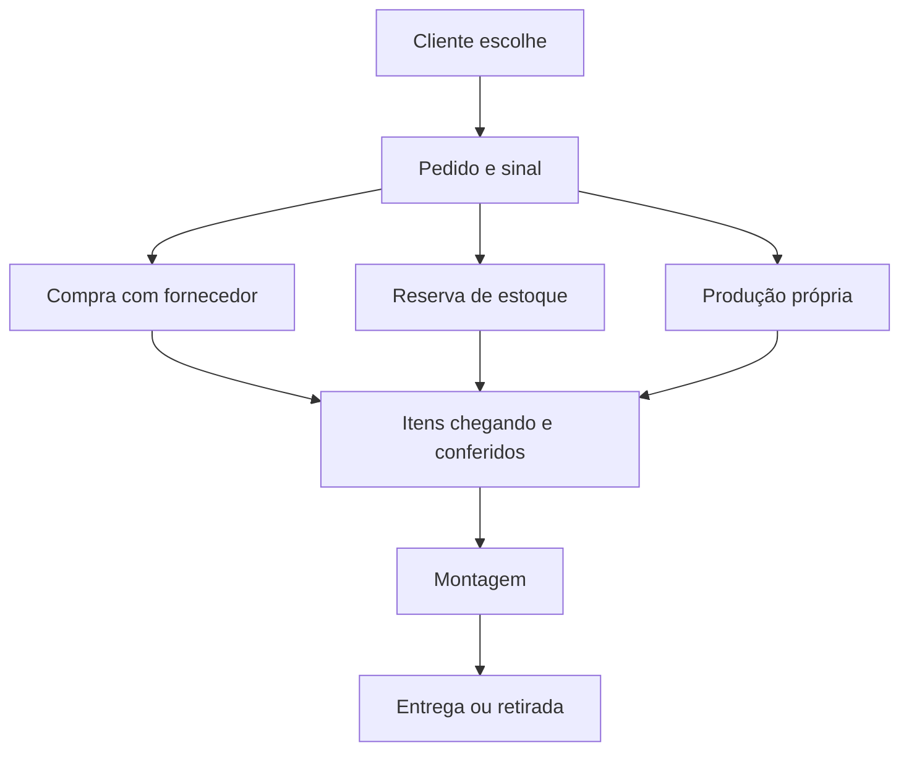

# Encomendo — Product Overview

**Encomendo is a SaaS platform for small Brazilian businesses that sell made-to-order, customized or assembled products.** The client builds an order, the business buys or makes only what was sold, and everyone knows when it will be ready.

Its main purpose is to help businesses sell without keeping everything in stock, while keeping control over costs, payments and delivery dates.

## 1. Who uses it

| User | Where | What for |
| --- | --- | --- |
| **Owner or attendant** | Web app and Android app, with the same features in both (iOS later) | Managing orders, purchases, stock, production, catalog, clients and finances |
| **End client** | The store's own page, for example `altarpm.encomendo.com.br`; login is optional | Building an order and following it until delivery |

Clients can order and follow an order through its link without an account. A client who logs in (with a one-time email code or a Google account) gets **Minhas encomendas**: every order from every Encomendo store in one place, reachable from any store page. Each store still sees only its own orders and customers.

Suppliers, costs, margins and internal alerts stay in the management apps.

## 2. Product catalog and sourcing

Business owners create items, components and ready kits. The sourcing mode belongs to each catalog item, not to the business, so a single order can mix all three.

| Sourcing mode | When the item is ready |
| --- | --- |
| **Sob encomenda** | After the supplier's lead time; the purchase is tied to the order. |
| **Estoque** | Immediately, if enough is on hand and reserved for the order; otherwise after the supplier's lead time, with a "sem estoque" warning. |
| **Produção própria** | After the production time plus the wait for free capacity, tracked on a production board with a weekly capacity number. |

A ready kit has a fixed price. When the client swaps an item, the kit price changes by the difference between the two items at single-item price, the kit discount stays, and the date is recalculated.

## 3. The store page

Each business gets its own page at a subdomain of encomendo.com.br, built from a niche template. Clients can:

- Browse ready kits (**Kits prontos**).
- Build their own order with **Monte o seu**, seeing the total, deposit and ready-by date update live.
- Place the order and pay the deposit.
- Follow the order: delivery forecast, steps, items in plain words, payment summary and a WhatsApp button.
- Optionally log in to see all their orders from every Encomendo store.

Owners customize the page with a logo, a brand color, a cover photo and sections switched on or off. Status colors, contrast and layout stay fixed so every store page stays readable and there is one front end to support.

## 4. Order flow



1. **Cliente escolhe:** a ready kit, or builds their own with Monte o seu.
2. **Pedido e sinal:** the system calculates the delivery date and the client pays the deposit. By default, purchasing is released only after the deposit; the owner can change this.
3. **Compras, estoque e produção:** items to buy are grouped by supplier, stocked items are reserved and in-house items go to the production board.
4. **Itens chegando:** each item has an expected date. On arrival it is checked against a checklist, with photos of the item and the invoice, and marked "Tudo certo" or "Com defeito".
5. **Montagem:** starts when every item has arrived (or is ready) and has been checked.
6. **Entrega ou retirada:** the client pays the balance and the order is delivered or picked up. Photos stay in the order history.

## 5. Supplier purchasing

- Items to buy are grouped by supplier automatically, and every purchase line points to one order and one client (or to stock).
- The supplier order goes out through a free WhatsApp link (wa.me) with the message prefilled. It never carries the client's name or phone.
- The supplier's promised date is recorded on each line and feeds the delivery estimate.

## 6. Delivery date and alerts

Encomendo calculates the delivery date instead of the owner guessing it:

```
Entrega = data em que o último item fica pronto + montagem + margem de segurança
```

Each item's ready date comes from its sourcing mode (section 2). Example, Kit Scrambler CB 500X: 15 days (leather seat, the slowest) + 3 assembly + 2 margin = 20 days.

The system warns before a date slips:

- **Precisa chegar até:** the delivery date minus the assembly days, which is the last day an item can arrive without making the client late.
- **Pode atrasar:** the supplier's expected date is after that limit. The order screen shows ways to fix it, such as switching to a backup supplier.
- **Atrasada:** the expected date passed and the item has not arrived.

The client never sees "Pode atrasar". When the date changes, the owner revises it and warns the client through a WhatsApp link.

## 7. Management apps

The **Hoje** screen shows what needs the owner today: summary cards, orders sorted by delivery date with items received, "Precisa de você" alerts and today's purchases.

Menu: Hoje · Pedidos · Compras · Produção · Estoque · Catálogo · Clientes · Financeiro. Produção and Estoque appear only when the business turns them on.

## 8. Target market

Encomendo serves many niches through templates: each one presets categories, item fields (such as the motorcycle model, roof type or room an item fits), default sourcing per category, sample kits and wording.

| Group | Segments |
| --- | --- |
| **Strongest fits** | Solar installers, custom PC builders, planned furniture (marcenaria), car customization (sound, lighting, wheels), boat outfitting |
| **Good fits** | Opticians (frame + lab lenses), bathroom and kitchen remodels, custom bicycles and e-bikes, uniforms and promotional merchandise |
| **With stock and in-house production** | Bakeries and cake shops, print shops, sign makers, furniture shops with their own workshop, tailors, 3D printing, auto parts stores taking special orders |
| **Also in scope** | Motorcycle customization, automotive accessories, jewelry, personalized gifts, party decoration kits, clothing, small manufacturers |
| **Worked backwards from a fixed date** | Events and weddings: the last day to order each item |

Solar and furniture look like the largest markets in Brazil.

## 9. Core value proposition

### Reduce working capital requirements

Buy components with confirmed client deposits instead of financing every order upfront.

### Reduce unnecessary inventory

Sell products without stocking every possible configuration.

### Increase sales opportunities

Offer more products and customization options without a matching increase in inventory.

### Keep promises

A delivery date calculated from the real lead time of every item, and a warning before it slips.

### Save operational time

Replace spreadsheets and manual calculations with one workflow. Conversations stay in WhatsApp: Encomendo opens them with prefilled wa.me links and keeps those links in the order history.

### Improve client confidence

A store page that shows prices, dates, payment status and progress, and answers "when is it ready?" on its own.

## 10. Product positioning

The back-office half of Encomendo already exists in manufacturing ERPs such as Odoo, MRPeasy and Katana, and in Brazilian systems such as Bling and Omie. What these don't offer is the combination Encomendo is built around:

- A client-facing kit builder where price and ready-by date change live.
- Niche templates ready on day one instead of an ERP set up per company.
- "Pode atrasar" explained in plain words, with ways to fix it.
- Supplier orders through free wa.me links.
- A monthly price a small shop can pay, with no implementation project.

Unlike e-commerce platforms, which sell inventory that already exists, Encomendo is designed around products that may not exist yet when the client orders.

## 11. Elevator pitch

### English

Encomendo helps small businesses sell customized and made-to-order products without carrying unnecessary inventory. From the client's own store page to supplier purchasing, production, assembly and delivery, it manages the whole order and tells everyone when it will be ready.

### Português — mercado brasileiro

O Encomendo é uma plataforma de gestão e vendas para negócios que trabalham sob encomenda. Venda produtos personalizados, receba sinais, organize compras com fornecedores, acompanhe a produção e cumpra seus prazos — tudo em um só lugar.

### Slogan

> Venda primeiro. Compre o necessário. Entregue com confiança.
